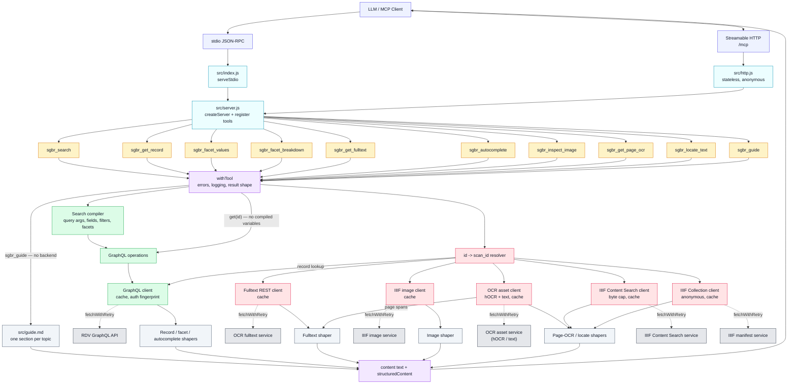

# Books As Data MCP Server

[](https://modelcontextprotocol.io/specification/2026-07-28) [](https://www.npmjs.com/package/@modelcontextprotocol/server)

A pilot [Model Context Protocol](https://modelcontextprotocol.io) (MCP) server that permits LLM-assisted natural language search and exploration of [*Books as Data*](https://books-as-data.ch/en), the digitised-books platform of four Swiss libraries (UB Bern, UB Basel, ZHB Luzern and ZB Zürich), through its GraphQL API.

> This MCP server was developed by the [Research and Infrastructure Support](https://rise.unibas.ch/en/) (RISE) group at the University of Basel. We are particularly interested in exploring the research opportunities, methodological risks, and technical challenges posed by retrieving and analysing data with LLMs. If you would like to collaborate with us in this area, please [get in touch](mailto:rise@unibas.ch).

## Sample Research Scenarios

The sample [research-scenarios](docs/research-scenarios.md) are multilingual prompts designed to test/demo the MCP server's capabilities, plus one example query that draws on the Books as Data CLI client. Alongside each prompt is a `demo` link to a previously saved response generated in Claude which you can consult to see how the server works in practice.

## Install

### Hosted (Streamable HTTP)

The easiest way to start is to install the Books as Data plugin. It adds the hosted server as a connector, together with a short skill that tells the AI assistant how to use it. The server needs no account and no sign-in.

**Claude** ([claude.ai](https://claude.ai), or the Claude desktop app):

1. Download [`books-as-data-claude.zip`](https://github.com/kintopp/books-as-data/raw/refs/heads/main/plugin/books-as-data-claude.zip).
2. In Claude, go to _Customize_ → _Plugins_ → _Add_ → _Upload plugin_ and choose the file.
3. Open the plugin, go to its _Connectors_ tab, and add the "Books-as-Data" connector.
4. If you like, set the permissions for its tools in _Customize_ → _Connectors_, for example to "Always allow". All tools are read only.

A free Claude account allows only one custom connector, and the plugin's connector counts as one. To make room for it, remove (not just disable) any other custom connector in _Customize_ → _Connectors_ first. Anthropic's [plugin instructions](https://claude.com/docs/plugins/overview#install-a-plugin) give more details.

**ChatGPT** (desktop app):

1. Download [`books-as-data-chatgpt.zip`](https://github.com/kintopp/books-as-data/raw/refs/heads/main/plugin/books-as-data-chatgpt.zip).
2. In the ChatGPT desktop app, go to _Settings_ → _Plugins_ → _Add_ and choose the file.
3. If ChatGPT asks you to connect the plugin's app, select _Connect_. No sign-in is needed.

**Other AI clients:** add the hosted server as a remote MCP server (often called a "custom connector") with this URL, and leave the authentication settings empty:

```
https://books-as-data-test.up.railway.app/mcp
```

See your client's own documentation for where to enter it.

Every tool reads the public books-as-data.ch services. To host your own instance, see [docs/deploy.md](docs/deploy.md).

### Local (stdio)

Requirements: Node.js ≥ 24.22.1 < 25 (no native dependencies).

```bash
git clone https://github.com/kintopp/books-as-data.git
cd books-as-data
npm install
```

The MCP client (e.g. Claude Desktop, OpenAI Codex) starts the server itself, on demand, once it's registered as shown below. `npm install` is still required — it fetches the two runtime dependencies and checks the Node version against the `engines` range. To verify the install without a client, run `npm test`. Note that currently (October, 2026) Mistral Vibe can't use a locally hosted MCP server.

#### Register with an MCP client

Point the MCP client at the entry file, using **absolute paths** for both `command` and the script:

```jsonc
{
  "mcpServers": {
    "books-as-data": {
      "command": "/absolute/path/to/bin/node",
      "args": ["/absolute/path/to/books-as-data/src/index.js"]
    }
  }
}
```

On **Windows**, with doubled backslashes which JSON requires in every path:

```jsonc
{
  "mcpServers": {
    "books-as-data": {
      "command": "C:\\Program Files\\nodejs\\node.exe",
      "args": ["C:\\path\\to\\books-as-data\\src\\index.js"]
    }
  }
}
```

For Claude Desktop, the config file is `claude_desktop_config.json` in `~/Library/Application Support/Claude/` (macOS) or `%APPDATA%\Claude\` (Windows). After editing it, fully quit and restart Claude Desktop — on Windows that means exiting from the system-tray icon.

For the ChatGPT desktop app, the MCP configuration file is `~/.codex/config.toml` on macOS or `%USERPROFILE%\.codex\config.toml` on Windows. The app shares this configuration with the Codex CLI and IDE extension. The format is TOML, not JSON: translate the snippets above into a `[mcp_servers.books-as-data]` table with `command = "…"` and `args = […]` keys.

No credentials are needed — the server queries the GraphQL API anonymously (the API is open; the default endpoints are the public `books-as-data.ch` production services the website itself uses). Optionally set `SGBR_ACCESS_TOKEN` to reach ACL-restricted records; see [Configuration](#configuration-env-vars).

#### Claude Desktop bundle (`.mcpb`)

For a one-click install with [Claude Desktop](https://claude.com/download) (macOS, Windows or Linux), build the bundle (the `mcpb` CLI is a devDependency, installed by `npm ci` — no global install needed). The bundle runs on Claude Desktop's own bundled Node 24 and needs no manual config-file editing:

```bash
npm ci
npm run build:mcpb     # → dist/books-as-data.mcpb — open it with Claude Desktop
```

The install dialog offers an optional access token plus four optional endpoint overrides (GraphQL / full-text / IIIF image / OCR mediaserver), so an installed bundle can be repointed without a rebuild when the backend moves hosts. A pre-built `.mcpb` installer is attached to the [latest GitHub release](https://github.com/kintopp/books-as-data/releases/latest).

## Tools

All ten tools are read-only and return both a human-readable summary (`content[].text`) and structured data (`structuredContent`). A typical flow: search → refine with facets/autocomplete → open a record → read its full text or inspect a page image.

| Tool | What it does |
|---|---|
| [`sgbr_search`](docs/tools.md#sgbr_search) | Full-text / faceted search over the ~1.07M-record corpus, relevance-ranked by default or sorted by publication year or title; narrow by library, language, genre, object type / foldouts, a year range, and more. Returns compact records, each with an `id` for follow-up — plus keyword-in-context snippets from the OCR text when the query matches a scanned item's body. |
| [`sgbr_get_record`](docs/tools.md#sgbr_get_record) | Full detail for one record `id`: bibliography, a ready-to-use CSL-JSON citation, IIIF manifest, full-text links, a shareable viewer URL, and GND/GeoNames authorities. |
| [`sgbr_facet_values`](docs/tools.md#sgbr_facet_values) | Breaks a query down by one dimension with record counts (per library, language, year, author, genre, topic, object type, foldout category, …), plus each dimension's enrichment coverage. |
| [`sgbr_facet_breakdown`](docs/tools.md#sgbr_facet_breakdown) | Cross-tabulates two dimensions in one call (e.g. language × genre), returning an exact N×M grid of record counts — auto-discovers each axis' top values, then prices every cell exactly with batched `stats` calls. |
| [`sgbr_get_fulltext`](docs/tools.md#sgbr_get_fulltext) | Retrieves the OCR full text of a scanned item, paged one character-window at a time (whole books are large) — or just a span of scan pages (`page_from`/`page_to`), e.g. the page `sgbr_locate_text` found. |
| [`sgbr_inspect_image`](docs/tools.md#sgbr_inspect_image) | Fetches one bounded page image (cover, map, fold-out plate, illustration, music notation) as JPEG bytes for the model's own visual analysis — the visual complement to the OCR text. One page per call, size-capped, whole page or a percent-region crop. |
| [`sgbr_autocomplete`](docs/tools.md#sgbr_autocomplete) | Type-ahead title / author / subject suggestions to turn a partial term into search phrases for `sgbr_search`. |
| [`sgbr_get_page_ocr`](docs/tools.md#sgbr_get_page_ocr) | Fetches one page's OCR text plus its layout regions (block / line / word boxes) from IIIF hOCR, each with pixel `bbox_px` and a percent `region_pct` that feeds straight into `sgbr_inspect_image` to crop and visually verify that exact spot. |
| [`sgbr_locate_text`](docs/tools.md#sgbr_locate_text) | Finds which page(s) of a scanned book contain a phrase, in one scan volume — asking the platform's IIIF content search first and falling back to a page-by-page scan of the normalized OCR — returning a page, a context snippet, and line/word regions (`bbox_px` + `region_pct`) per hit; also lists sibling volumes for multivolume works. |
| [`sgbr_guide`](docs/tools.md#sgbr_guide) | Serves the research guidance for the other tools, one topic per call, e.g. the collection, query-syntax traps, historic spelling, OCR, facets, citing pages, fold-out plates. A model reads it before its first search. |

See [tool descriptions and parameters](docs/tools.md) for the description of each individual tool and its full parameter list.

## Skill file

The research guidance (which tool to choose for a given question type, how to combine searches, important metadata distinctions, and known limitations) is served by the server itself through `sgbr_guide`, so every client always receives the current version.

The plugins above already include the skill. On its own, the [skill](skill/) is optional: a `SKILL.md`, zipped in a `.skill` file (with a `.skill.zip` copy for clients and browsers that only accept `.zip`), that sends the model to `sgbr_guide`. If you installed an earlier version of the Books as Data skill, which held a full copy of the guidance, please uninstall it.

## Architecture overview



## CLI

`scripts/cli.mjs` (bin `bbad`) is a headless command-line client for a curated ten-verb subset of the MCP tools — useful for quick queries, piping into `jq`, and scripted checks. It's an MCP **client**, not a second implementation: it spawns the server over stdio and calls the same tools an LLM would, so a CLI query and an LLM query return identical results. stdout is pure JSONL; counts, warnings and note: lines go to stderr. The notes restate any caveat a tool reports (e.g. a capped or truncated result), so a partial result is never piped on as a complete one; --quiet suppresses them.

The examples below use `npm run cli --`, which works in a fresh checkout with nothing else installed. To invoke it as `bbad` put the bin on your PATH with `npm link` from the checkout; both run the same script.

```bash
npm run cli -- search "Basel" --max 5 --fields id,title,date
npm run cli -- facets language --query Basel --table
npm run cli -- get id991104550959705501_UBBS-00173645
npm run cli -- crosstab language --breakdown genre --query Basel --json
npm run cli -- locate "Beschäftigungen" --scan_id ZBZ-00057370 --level line

bbad search "Basel" --max 5 --fields id,title,date   # the same call, after `npm link`
```

Ten verbs: `search`, `get`, `facets`, `fulltext`, `comp` (autocomplete), `inspect` (page image), `crosstab` (facet breakdown), `pageocr` (per-page OCR text + layout regions), `locate` (find which page(s) contain a phrase), and `guide` (a topic of the research guidance). Each command's parameters are documented by its own `--help`, generated live from the tool's own schema:

```bash
npm run cli -- --help          # verbs and global flags
npm run cli -- search --help   # parameters for one verb
```

`crosstab`'s result is a nested grid (`rows[].cells[]`), not a flat list, so `--json` (the full `structuredContent`) is the authoritative output; default (JSONL) output emits one `rows[]` object — with its own `cells[]` array — per line, and `--table` remains only a rough preview (nested `cells` stringify and truncate under the existing renderer).

## Configuration (env vars)

| Var | Default | Purpose |
|---|---|---|
| `SGBR_GRAPHQL_ENDPOINT` | `https://books-as-data.ch/query/graphql` | RDV GraphQL API (search, records, facets). Its host also serves the IIIF Content Search `sgbr_locate_text` asks first, and the records' bulk zip links. |
| `SGBR_FULLTEXT_ENDPOINT` | `https://books-as-data.ch/gbooksapi/v1/swissgbooks_api` | REST OCR full-text base (`sgbr_get_fulltext`). |
| `SGBR_IMAGE_ENDPOINT` | `https://books-as-data.ch/media/iiif/3` | IIIF Image API base for page images (`sgbr_inspect_image`). |
| `SGBR_OCR_ENDPOINT` | `https://books-as-data.ch/media` | Base URL serving the per-page OCR assets (hOCR/text) for `sgbr_get_page_ocr` / `sgbr_locate_text` and `sgbr_get_fulltext`'s page spans — the mediaserver base (without `SGBR_IMAGE_ENDPOINT`'s `/iiif/3` segment), overridable separately so it can move independently of the image base. |
| `SGBR_FRONTEND_URL` | current portal (`https://books-as-data.ch`) | Front-end base for the `viewer_url` returned by `sgbr_get_record`, `sgbr_inspect_image`, and the page-OCR/locate tools (`{base}/en/detail/{id}`). |
| `SGBR_ACCESS_TOKEN` | _(unset)_ | Optional OIDC bearer token → `Authorization` header, to reach ACL-restricted records. Leave unset for anonymous/public access (the default). |
| `SGBR_TIMEOUT_MS` | `30000` | Per-request timeout. |
| `SGBR_RESULT_CHAR_CEILING` | `150000` | Per-result size budget. |
| `SGBR_ENTRY_POINT` | `stdio` | Entry-point tag in the outbound `User-Agent` (`ub-sgbr-mcp/<version> (<entry>)`), so the library can attribute this server's traffic. The Desktop bundle sets `mcpb` and `bbad` sets `cli`; you normally leave it alone. |
| `SGBR_LOG` | off | `1` writes one JSON line per tool call to stderr (tool, latency, success, input). |

To host your own instance, run `npm run serve`, which serves stateless Streamable HTTP from `src/http.js`. [docs/deploy.md](docs/deploy.md) describes the setup, the HTTP variables, and the limits.

## Development

```bash
npm start                # serve over stdio manually (waits for an MCP client; Ctrl-C to stop)
npm run serve            # serve over Streamable HTTP at /mcp (anonymous only)
npm run lint             # ESLint (flat config, Node 24)
npm test                 # offline suite: protocol smoke test + unit tests
npm run test:cli         # just the CLI's own offline assertions
npm run test:live        # ALSO run the live tests for the tools (= SGBR_LIVE=1 npm test)
npm run test:pack        # pack → install with --omit=dev → launch both bins (needs the npm registry)
npm run build:mcpb       # build the Claude Desktop bundle → dist/books-as-data.mcpb
npm run build:skill      # sync SKILL.md's version, repack skill/<name>/ → the committed .skill zip + .skill.zip copy + plugin/books-as-data/
npm run build:docs       # regenerate docs/tools.md's generated blocks from the server
npm run inspector        # open the MCP Inspector against the server
```

The offline suite stubs the backend by construction, so it can never catch the real one
moving: run `npm run test:live` before a release and after any backend-host change. Editing
`SKILL.md` means running `npm run build:skill` and committing the result (`SKILL.md`, `.skill` and its `.skill.zip` copy, and the plugin's skill copy and manifests) —
nothing else regenerates them, and `test/skill.test.js` fails if they disagree.

CI (GitHub Actions, `.github/workflows/ci.yml`) runs two jobs on Node 24. **`build`** does `npm ci`, `npm run lint`, the offline `npm test`, and `npm run build:mcpb`. **`pack`** does `npm run test:pack`, which packs the tarball, installs it into a temp dir with `--omit=dev`, and launches both shipped bins for real — kept a separate job because it must reach the npm registry, which the offline suite deliberately avoids. The live tests (`SGBR_LIVE=1`) hit the public production APIs and are intentionally not run in CI, pending the library's policy on MCP access to its endpoints.

```
src/
  index.js            entry — serveStdio(createServer)
  http.js             entry — stateless Streamable HTTP (not in the .mcpb bundle)
  http-config.js      the HTTP entry's own settings (port, limits)
  server.js           McpServer factory + tool registration
  config.js           endpoint, view, field maps, budgets
  guide.md            the research guidance sgbr_guide serves, one ## per topic
  graphql/            client.js (errors[] parsing + LRU/TTL response cache),
                      operations.js (the query documents)
  fulltext/client.js  REST OCR fetch (normalize, cached)
  image/client.js     IIIF page-image fetch (cached bytes)
  ocr/client.js       per-page OCR asset fetch — hOCR + text (cached)
  contentsearch/client.js  IIIF Content Search fetch — byte-capped, cached
                      (sgbr_locate_text's first engine)
  collection/client.js  IIIF Collection manifest fetch — anonymous, cached
                      (multivolume sibling enumeration)
  search/compiler.js  high-level args → GraphQL variables (search + facet)
  lib/                shapers: record.js (compact search hits), detail.js
                      (full record + citation/IIIF/authorities), facet.js,
                      facet_breakdown.js (cross-tab grid), fulltext.js
                      (windowing), autocomplete.js, image.js (IIIF URL +
                      response shaping), ocr.js (hOCR → layout regions + asset
                      URLs), locate.js (normalize/match + locate shaping);
                      plumbing: http.js (the one fetch/timeout/retry loop every
                      client shares), tool.js (withTool handler wrapper),
                      resolve.js (id → scan_id resolution), cache.js
                      (LRU+TTL+dedup), auth.js (bearer token seam), errors.js,
                      warnings.js (query-misuse hints), vision.js (image
                      delivery-size solver), progress.js (progress
                      notifications), guide.js (splits guide.md into
                      topics), origin.js (the HTTP entry's Origin/Host
                      checks), async.js, prune.js, applied.js
  tools/              search.js, get_record.js, facet_values.js,
                      facet_breakdown.js, get_fulltext.js, autocomplete.js,
                      inspect_image.js, get_page_ocr.js, locate_text.js,
                      guide.js, filter-schema.js (shared filters schema)
test/                smoke.test.js (real stdio server) + offline unit tests
                      (compiler, record, facet, config, clients, …)
```


## License

[MIT](./LICENSE) © 2026 University of Basel.
