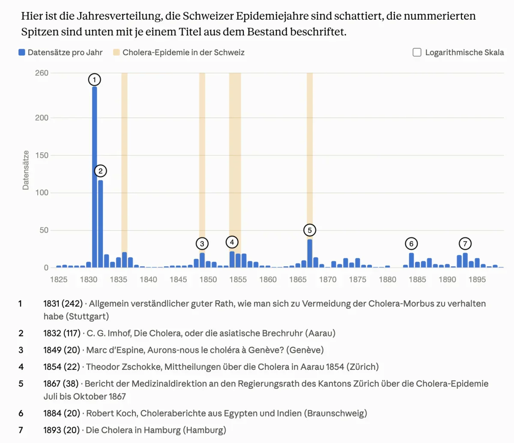
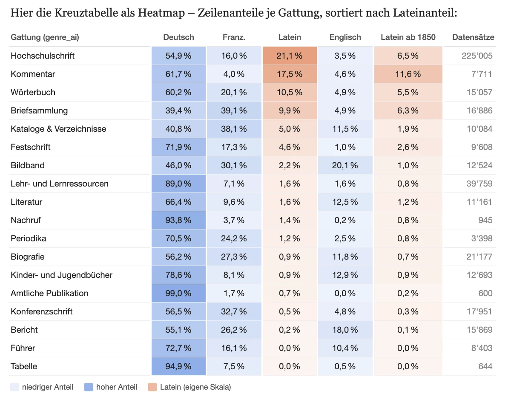

# Research Scenarios

Each scenario below is a hypothetical research question phrased as a literal prompt you can paste into a chat session. Alternatively, click on the demo link underneath each prompt to see a previously saved example of how it was answered by Anthropic's Opus 5.5 model in Claude Desktop. The `/books-as-data` at the end of each saved prompt is a convention for requesting the model to consult the appropriate [skill file](../skill/books-as-data/SKILL.md) before answering, which sends it to the guidance served by `sgbr_guide`. The final example is a command-line pipeline for technical users working with the CLI client rather than a chat application.

A few scenarios add an optional follow-up requesting a visualisation. These exploit the fact that every tool returns machine-readable structured data alongside its prose summary. On this basis, for example, a set of statistics can become an interactive chart or a fold-out table can be converted into a CSV file.

- [Surveying the Corpus](#surveying-the-corpus)
- [Cross-Tabulating the Corpus](#cross-tabulating-the-corpus)
- [Searching a Historic Corpus](#searching-a-historic-corpus)
- [Reading the Full Text](#reading-the-full-text)
- [Looking at What OCR Cannot Read](#looking-at-what-ocr-cannot-read)
- [For the Library](#for-the-library)

Note: The inconsistent mix of languages in the answers is a side-effect of Claude deciding case-by-case between a default English language setting (requested by the user in the system prompt) and responding to the user in the same language as their prompt.

## Surveying the Corpus

`sgbr_facet_values` takes the records matching a search and counts them by one category — publication year, language, library, genre or author. For example, it shows how many books about cholera appeared in each year, or in each language. The counts are exact, not estimates. Counted by year, the corpus becomes a time series. A record spanning several years (serials, multi-volume works) is counted in every year it covers, so the yearly counts add up to more than the number of records.

### 1. Print as a Seismograph of Epidemic

*Die Cholera erreichte die Schweiz im 19. Jahrhundert in mehreren Wellen — zuletzt in der Zürcher Epidemie von 1867. Zeichnet sich das im Buchbestand ab? Wie verteilen sich Publikationen über die Cholera über das Jahrhundert, und was für Schriften sind das eigentlich in der ersten Welle im Vergleich zur letzten?* [Demo](https://claude.ai/share/68f66a85-f162-471d-9e8b-f6ed95d98063)

**How the tools enable it:**
- `sgbr_facet_values` with `facet: "year"`, `query: "Cholera"`, `scope: "title"` returns the per-year distribution of books *about* cholera. Title scope matters: the default scope would also count every book that merely mentions the word in its full text.
- `sgbr_search` with the same query and a `year_from`/`year_to` window around a wave retrieves its titles, and `language` and `publication_place` facets show what languages it was written in and where it was printed.
- Leaving out the individual volumes of multivolume works (`exclude: { object_type: ["volume"] }`) stops one long work from being counted again in every year it spans.

**Why it matters:** That publication spikes with epidemics is expected; *what kind* of print each wave produced is not: in 1831, popular advice and remedies against an approaching "Asiatic" plague; by 1867, official reports, epidemic statistics and the Pettenkofer controversy over transmission.

**Optional follow-up:** *Stell die Jahresverteilung als Diagramm dar, markiere die Epidemiejahre, und beschrifte die auffälligsten Spitzen mit je einem typischen Titel aus diesem Jahr.*

<p align="center"></p>

### 2. When German Displaced Latin in the Dissertation

*Wann löste das Deutsche das Latein als Sprache der Dissertation ab? Nimm die Hochschulschriften im Korpus und verfolge den Anteil lateinischer gegenüber deutschsprachiger Arbeiten über das 18. und 19. Jahrhundert — Zwanzigjahresschritte reichen.* [Demo](https://claude.ai/share/0ab73e0e-ace0-4ba2-b7af-9b5f609efd1b)

**How the tools enable it:**
- `sgbr_facet_values` with `facet: "genre"` confirms the exact catalogue value (`Hochschulschrift`) and its size.
- `sgbr_facet_breakdown` cannot take `year` as an axis, so the time series comes from one `sgbr_facet_values` call per twenty-year period, with `facet: "language"`, `filters: { genre: ["Hochschulschrift"] }` and the period as `year_from`/`year_to`. The same call per decade shows when the majority changed. Adding up yearly counts instead would give totals that are too high, because a work published over several years is counted once in each of those years.
- A `publication_place` facet per period shows where a language spike comes from, and whether the imprint predicts the language.

**Why it matters:** The switch from Latin to German in academic writing is usually dated from institutional decrees — the year a faculty first permitted German theses. Counted across tens of thousands of actual dissertations, the switch comes late and unevenly: Latin remains the majority until around 1870, and the imprint alone largely predicts the language, so the change went university by university rather than all at once. The corpus's unusual depth in academic ephemera is what makes the question answerable at scale.

### 3. Dating an Orthographic Change from Title Pages

*Wann verschwindet die Schreibung „Schweitz" aus den Buchtiteln? Vergleiche die zeitliche Verteilung von „Schweitz" und „Schweiz" in den Titeln des Korpus und sag mir, wann die alte Form kippt.* [Demo](https://claude.ai/share/465bd703-8a81-4e4b-9e7d-f5796f46a3ff) 

**How the tools enable it:**
- Two calls to `sgbr_facet_values` with `facet: "year"`, `scope: "title"` and `filters: { language: ["Deutsch"] }`, one for `query: "Schweitz"` and one for `"Schweiz"`, return both curves. Because the two spellings are compared with each other, it doesn't matter that the corpus holds more books for some years than for others.
- Searching only titles matters because full-text counts would rise and fall with the number of digitised books per year, not with the spelling. The language filter keeps out Scandinavian titles, where „Schweitz" stays the normal form.
- `sgbr_search` in the later years finds the last German titles with the old spelling, and the hits that distort the count: those that mean the canton of Schwyz, and titles whose spelling cataloguers normalised.

**Why it matters:** Spelling changes are usually dated from dictionaries and school regulations, which prescribe how a word should be spelled. Title pages show how printers actually spelled it, and that the change did not happen everywhere at once: Leipzig travel literature switched around 1776, while Zürich publishers kept „Schweitz" into the 1780s. There is a practical consequence too: the index does not normalise spelling, so anyone searching only for the modern form silently misses most of the eighteenth century.

### 4. How Good Is the Text I'm Counting?

*I want to build a corpus of German sermons printed 1750–1800 for text mining. How many have full text, and how good is the OCR? Does quality differ by period, or between single-sermon pamphlets and books? If a quality threshold would skew the sample, show me by how much.* [Demo](https://claude.ai/share/503a0bf5-5fd9-497a-8567-80f2080f326c)

**How the tools enable it:**
- Neither `genre` nor `genre_ai` has a sermon category, so a title-scoped query (`Predigt*` plus compounds like `Leichenpredigt*`, `Kanzelrede*`) with `filters: { language: ["Deutsch"] }` and `year_from`/`year_to` defines the set of sermons. Only a record with its own scan has a quality score, so a multivolume work is scored volume by volume, not as a whole.
- Repeating the count with rising `ocr_quality_min` values shows how many volumes fall into each quality band.
- Repeating the counts under `pages_max` and `pages_min` separates pamphlets from books, year ranges compare periods, and a `library` facet shows where each format comes from.

**Why it matters:** Text mining usually treats OCR errors as random noise that evens out in a large sample. It does not: a threshold of 85 removes a quarter of the pamphlets but 3% of the books, and because the two formats come from Reformed and Catholic libraries respectively, a quality filter probably shifts the balance between Protestant and Catholic texts as well as between formats. The quality score lets you measure these effects before downloading anything.

## Cross-Tabulating the Corpus

`sgbr_facet_breakdown` counts records across two categories at once — language × genre, library × availability, author × subject — and returns a table. It picks the most common values of each category by itself and counts every combination exactly. This saves running one count per row and assembling the table by hand.

### 5. Which Genres Kept Latin

*Ich möchte die sprachliche Arbeitsteilung des Korpus auf einen Blick: welche Gattungen wurden noch lateinisch verfasst, welche schon deutsch oder französisch? Kreuz alle Gattungen gegen die Hauptsprachen und zeig mir, wo sich das Latein am zähesten hält.* [Demo](https://claude.ai/share/91a128d2-93be-496e-8b97-cf55ab49b8e4)

**How the tools enable it:**
- `sgbr_facet_breakdown` with `facet: "genre_ai"` for the rows and `breakdown: "language"` for the columns returns the grid in one call. The AI-predicted `genre_ai` covers ~40% of records against ~11% for the catalogued `genre`, so it reaches more of the corpus; the same call with `facet: "genre"` serves as a cross-check.
- Running the call again with `year_from: 1850` gives the figures for 1850 onwards, shown as a "Latin after 1850" column. Subtracting them from the full table gives rough figures for the years before 1850. They are only rough because a work published over several years, say 1845–1855, is counted on both sides.
- Each row ends with a `total`: the number of records in that genre. Adding up the row's cells won't give the same number, for two reasons. A book in two languages appears in two cells, and books in languages without a column of their own appear in none. Each cell simply counts the records of that genre in that language.

**Why it matters:** A language profile of the corpus is usually quoted one figure at a time — this much Latin, that many dissertations. The table shows what totals per language or per genre hide: Latin did not thin out evenly across print, it withdrew into a handful of learned genres — dissertations, commentaries, dictionaries, letter editions — and held longest where it remained the language of the discipline. That the cells don't add up to the row totals is not an error: a record can list several languages, and the tool reports both numbers.

**Optional follow-up:** *Zeichne die Kreuztabelle als Heatmap — eine Zeile je Gattung, die Zellen als Anteil an der Gattung, sortiert nach dem Lateinanteil. Ergänze eine Spalte „Latein ab 1850" und die Zahl der Datensätze je Gattung, damit sich kleine Gattungen mit grossen vergleichen lassen.*

<p align="center"></p>

## Searching a Historic Corpus

`sgbr_search` finds words and phrases, including approximate spellings and word beginnings (`Predigt*`). A search can be limited to titles, authors, full text or the plates' image descriptions, and narrowed by category, year, page count or OCR quality. Full-text hits come with short passages around the match. To find an author's standard name, use the `author` facet rather than `sgbr_autocomplete`.

### 6. One City, One Surname, Many Authors

*Ich arbeite zu Jacob Burckhardt — aber in Basel heisst gefühlt jeder zweite Autor Burckhardt. Welche Namensformen des Historikers stecken im Index, wie halte ich ihn von den übrigen Burckhardts auseinander, und welche seiner Schriften hat das Korpus?* [Demo](https://claude.ai/share/85a7aa66-967f-4721-b75d-e6ea44a638a2)

**How the tools enable it:**
- `sgbr_facet_values` with `facet: "author"` over `query: "Burckhardt"`, `scope: "author"` lists each identity with its record count, life dates and GND identifier, which tells the historian apart from his father of almost the same name. Variants without a GND identifier belong in the same `filters: { author: [...] }`.
- A `year` facet over that filter exposes records dated before his birth: the author field also lists former owners, a role (*Vorbesitzer*) that appears only in `sgbr_get_record` and cannot be filtered.
- Combining the author filter with a title-scoped query for his works isolates his own writings.

**Why it matters:** The author facet identifies people by their entry in the authority file, not by how the name is spelled, and the GND identifier links the person to the HLS, Wikidata and every other GND-linked resource. The subtler problem is that the same field records ownership as well as authorship: a nuisance for a bibliography, but for the history of a scholar's library it doubles as a provenance index.

### 7. An Earthquake Read from Its Witnesses

*Das Walliser Erdbeben vom 25. Juli 1855 — das stärkste Schweizer Beben des 19. Jahrhunderts — kennen wir vor allem aus zeitgenössischen Berichten. Durchsuche den Volltext des Korpus nach Wendungen wie «Erdbeben von Visp», «Erdbeben im Wallis» und «Erdstösse», und gib mir eine Tabelle: Titel, Jahr und die Fundstelle im Wortlaut — ich will die umgebenden Sätze lesen, nicht nur die Katalogeinträge.* [Demo](https://claude.ai/share/fd52b248-7281-4d07-9732-51e5eed57c44)

**How the tools enable it:**
- `sgbr_search` with `scope: "fulltext"` returns up to three short passages around each match; for this question the passage, not the catalogue record, is the evidence. Each phrase is searched on its own, along with its period and OCR spellings (`Erdstöße`, `Viſp`), because a query combining several terms finds the right books but often returns no passages.
- The snippets separate dedicated studies on sight from incidental witnesses and from entries in library catalogues.
- `sgbr_locate_text` pins a passage to its scanned page, `sgbr_get_fulltext` with `page_from`/`page_to` reads the surrounding paragraph, and `sgbr_inspect_image` with a `region_pct` checks the wording against the print, telling a printer's error from an OCR error.

**Why it matters:** Earthquakes from before the age of seismographs can only be studied through texts: the intensity estimates in the Swiss earthquake catalogue rest on exactly this kind of scattered contemporary testimony. A full-text index over a million books widens the source base beyond the canonical reports to incidental witnesses, and the passages make it feasible to sort through hundreds of candidates.

**Optional follow-up:** *Sortiere die Fundstellen in drei Gruppen — Augenzeugenbericht, wissenschaftliche Kompilation, blosse Erwähnung — und zieh aus den Augenzeugenpassagen die genannten Ortschaften als Liste heraus, damit ich sie kartieren kann.*

### 8. An Almanac Read Through Its Witnesses

*Le Messager boiteux paraît à Berne et à Vevey depuis le début du XVIIIe siècle. Quelles années de cet almanach le corpus conserve-t-il, dans quelles bibliothèques — et peut-on regarder les pages de titre de quelques millésimes?* [Demo](https://claude.ai/share/fa72ade2-1034-4ef5-8d92-9100802ccf4a)

**How the tools enable it:**
- `sgbr_search` with `scope: "title"` over `"Messager boiteux"` and its variants (`"véritable messager"`, the German *hinkende Bot*) finds the almanac's own copies, and their `availability` shows which can be looked at: a copy scanned by a partner library has no page images on the platform, so the page tools can't open it; the record links to the partner's site instead.
- `scope: "fulltext"` finds the books that mention the almanac, among them library catalogues that list years of the almanac the corpus doesn't have.
- Where the almanac itself is missing, a digitised history of it can stand in: its OCR points to the facsimiles it reprints, and `sgbr_inspect_image` shows them.

**Why it matters:** Almanacs reached print runs no learned book approached — for much of the countryside they were the *only* book bought annually — yet they survive worse than almost any other print: read to pieces, replaced every year, and rarely collected by learned libraries. The corpus shows that survival bias at once: two copies of the almanac against a nineteenth-century history and some 260 books that mention it.
## Reading the Full Text

`sgbr_get_fulltext` reads a digitised book's OCR text in sections, or a span of scan pages with each page marked. The text is uncorrected machine recognition of mostly Fraktur print — usable for finding and skimming, never quotable without verification. For page-level work, `sgbr_locate_text` finds the scanned page for a phrase, `sgbr_get_page_ocr` returns that page's text and layout boxes, and `sgbr_inspect_image` checks the crucial passage against the page image.

### 9. Finding Dialect Poetry despite poor OCR

*Johann Peter Hebel, 1760 in Basel geboren, schrieb seine Alemannischen Gedichte im Dialekt des Wiesentals. Welche Ausgaben hält das Korpus? Such mir „Erinnerung an Basel" heraus — „Z'Basel an mym Rhy" — und prüf die Verse am Seitenbild, bevor du etwas zitierst: beim Dialekt wird die OCR straucheln.* [Demo](https://claude.ai/share/880eded6-2bfe-4264-a64a-8cb4bcf219df)

**How the tools enable it:**
- `sgbr_search` with `scope: "title"` and `"Alemannische Gedichte"|"Allemannische Gedichte"` — both spellings OR-ed — surveys the editions. Many records are copies of one edition in different libraries, so records are not editions.
- The reliable way to the poem is its printed title, `"Erinnerung an Basel"` with `scope: "fulltext"`; a line of dialect is often garbled by the OCR, and a missing OCR hit is no proof of absence.
- `sgbr_locate_text` maps printed pages to scan pages, and `sgbr_inspect_image` on each page — and on an enlarged crop where a reading is in doubt — supplies the text that is quoted. The OCR serves only as a finding aid.
- `sgbr_get_record` supplies the citation: the `viewer_url` with `?page=`, the ARK, and `processed_on`, the date of the scan run whose page numbering is being cited.

**Why it matters:** OCR errors in dialect are hard to spot: the misread „Stuchl" looks as plausible as the correct „Stuehl" (chair), and a standard German dictionary knows neither. Having the model check the verses against the page image catches these errors.

**Optional follow-up:** *Erstell mir eine Lesefassung des Gedichts als Dokument zum Herunterladen: Originalverse nach dem Seitenbild korrigiert, daneben eine Zeile für Zeile nachgeführte hochdeutsche Übertragung — und vermerke, wo die OCR danebenlag.*

### 10. Where the Dragons Are

*Johann Jakob Scheuchzer hat die Schweizer Drachen gesammelt. Wie behandelt er sie in der „Natur-Historie des Schweitzerlandes" (1752) — als Tiere, als Lufterscheinungen, als Sage? Finde jede Stelle in allen drei Bänden, lies sie im Zusammenhang und gib mir zitierfähige Belege mit Seitenangabe.* [Demo](https://claude.ai/share/3b2269bf-ba9b-4df6-a343-ff8cfec3706c)

**How the tools enable it:**
- `sgbr_search` with `query: "Scheuchzer"`, `scope: "author"` and `full_text_only: true` lists the three volumes as separate records of one work. If you already have a scan id, `scope: "identifier"` finds its record.
- `sgbr_locate_text` with `engine: "page_scan"` matches a substring rather than a whole word, so one call per volume and stem — `drach`, `draco`, `wurm`, `schlang` — catches the compounds and inflections the default search misses. Stray matches such as *Drachma* are easy to discard.
- `sgbr_get_fulltext` with `page_from`/`page_to` reads a passage in context; its page markers keep scan and printed page numbers apart.
- `sgbr_inspect_image` verifies the key passages before they are quoted, and `sgbr_get_record` supplies the `viewer_url` with `?page=` for each citation.

**Why it matters:** Scheuchzer's dragons are usually told through a few famous engravings and his catalogue of sightings. Reading every occurrence across a whole work shows where the word sits in his system of nature. In 1752 he files it under weather, explaining the legends away as misread meteors. His catalogue of dragon sightings is in his earlier works, so anyone citing it needs those, not this edition.

## Looking at What OCR Cannot Read

Roughly a sixth of all records are single **fold-out plates** (`object_type: foldout`): maps, engineering drawings, statistical tables, botanical plates, music. Full-text search can't see what they show. Instead, AI has sorted them into some fifty categories (`foldout_type`: `Karten`, `Tabellen`, `Entwurfszeichnungen`, …) and given each a one-sentence description, which the default search includes. For a single plate, `sgbr_inspect_image` shows what it depicts and `sgbr_get_page_ocr` reads the lettering on it, such as place names or table headings.

### 11. The Gotthard on Paper

*Der Bau der Gotthardbahn ist in technischen Berichten mit grossen Falttafeln dokumentiert — Streckenprofile, Tunnelquerschnitte, Brückenpläne. Finde solche Tafeln aus den Jahren 1860–1890 und beschreib mir zwei oder drei im Detail: was genau ist dargestellt, in welchem Massstab, mit welcher Beschriftung?* [Demo](https://claude.ai/share/794ded0d-0cd9-4329-a149-5f2a93434139)

**How the tools enable it:**
- `sgbr_search` with `query: "Gotthard*"`, `filters: { object_type: ["foldout"] }` and `year_from`/`year_to` finds the plates, and `sgbr_facet_values` on `foldout_type` over the same query sorts them into categories such as `Karten`, `Tabellen` and `Entwurfszeichnungen`. The labels are assigned by AI, and a plate can carry more than one.
- `scope: "image_description"` searches only the plates' AI descriptions, which name what a plate shows rather than what its book is called.
- For each candidate, `sgbr_get_page_ocr` on the foldout `id` cheaply returns the lettering — title block, legend, scale — and `sgbr_inspect_image` shows what is drawn, with `region_pct` crops for small lettering.

**Why it matters:** Fold-out plates are usually hard to find: full-text search misses them, and in print the only way to find one is to page through the book it is bound into. Here each plate is a record of its own with a category, so the plates documenting the Gotthard railway can be collected and examined one by one.
### 12. Fold-Out Tables Back into Data

*Nineteenth-century Swiss emigration was tracked in printed statistical tables, often bound into reports as fold-out plates. Find such tables in the corpus and read one closely: which years, communes, and destinations does it distinguish, and what do the figures actually say?* [Demo](https://claude.ai/share/57677ddd-eb1f-4da3-b9da-978f0fc75f7c)

**How the tools enable it:**
- `sgbr_search` with `query: "Auswanderung"`, `filters: { object_type: ["foldout"], foldout_type: ["Tabellen"] }` finds the statistical plates.
- `sgbr_get_page_ocr` on the foldout `id` cheaply gives the row labels and headings, but on a dense grid it loses the column alignment of the figures. So the figures come from `sgbr_inspect_image`, read block by block in `region_pct` crops at full resolution.
- Once transcribed from the pixels, the figures can be checked against the table's own totals.

**Why it matters:** Swiss official statistics was born in this period and much of its output survives as fold-out tables. Read cell by cell from the page image, such a plate becomes structured data that can be checked against its own totals and percentages.

**Optional follow-up:** *Transcribe the table into CSV so I can analyse it — keep the original column headings, flag every cell you could not read with confidence, and give me the file for download.*

## For the Library

The `availability` category records what kind of data exists for each record: searchable full text, scans held by a partner institution, or catalogue data only. Combined with the `library` category, it shows how each contributing library's holdings are represented on the platform.

### 13. What Would an OCR Campaign Add?

*Take one library's contribution to Books as Data — use "Bern, UB Münstergasse" as the example — and break it down: what share is full-text searchable, what is scans-only, what is metadata-only? Compare that with the platform overall. I want to know what an OCR campaign over the existing scans would actually add to the searchable corpus.* [Demo](https://claude.ai/share/55a83d29-33bd-4971-996c-6a650dd80e6a)

**How the tools enable it:**
- `sgbr_facet_values` with `facet: "library"` finds the library's exact label among the contributing collections.
- `sgbr_facet_values` with `facet: "availability"` and `filters: { library: ["Bern, UB Münstergasse"] }` returns the library's whole breakdown in one call, and the same facet over an empty query gives the figures for the whole platform. Plates (`Falttafel`) are left out of the shares, since they are pages of volumes already counted.
- `sgbr_get_record` on a `Digitalisat (extern)` record shows no `scan_id`: the images and any OCR sit with the partner, and the record links to the partner's copy. A `scan_source` facet shows which partners these are.
- `ocr_quality_min` shows how much of the existing full text is of poor quality and would benefit from a new OCR run.

**Why it matters:** Only part of the corpus is searchable as full text. The rest was scanned by partner libraries or exists only as a catalogue record, so a full-text search covers only the first part. For a contributing library, the availability figures show how much of its collection researchers can actually search. For Bern they also show that no scans are waiting for OCR: the missing text lies with the partner libraries.

### 14. The Partner-Scan Gap, Ranked from the Shell

The CLI (`bbad`, or `npm run cli --` from a checkout) is a command-line client for the same MCP server. It writes the structured results an AI assistant receives as JSON to stdout, and warnings and count summaries to stderr, so its output can go straight into a `jq` pipeline:

```bash
# Partner-scanned records (images and any OCR held by the partner, nothing searchable here)
# as a count and as a share of a library's holdings, for the 25 largest contributors,
# ranked. One crosstab call → jq → sort.
bbad crosstab library --breakdown availability --size 25 --breakdown_size 4 --json \
  | jq -r '.rows[]
      | (.cells[] | select(.value == "Digitalisat (extern)").count) as $extern
      | [ .value, $extern, (100 * $extern / .total | round) ] | @tsv' \
  | sort -t$'\t' -k2 -nr | head -6
```

```
Zürich, ZB, Weitere Sammlungen      54356   28
Basel, Universitätsbibliothek       42149   11
Zürich, ZB, Alte Drucke und Rara    38265   24
Bern, UB Speichermagazin            26444   15
Bern, UB Münstergasse               19168   15
Luzern, ZHB                         17314   11
```

**Why it matters:** Because the CLI calls the same tools as the assistant, a figure reproduced at the shell is the figure the model would quote. Two caveats: a crosstab axis holds at most 25 rows, so this ranks the largest contributors, not all 131. And the percentage in the third column is out of all of a library's records, plates included; scenario 13 leaves the plates out, so Bern's share there is 20% rather than 15%.
